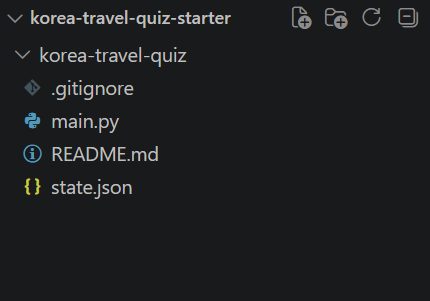
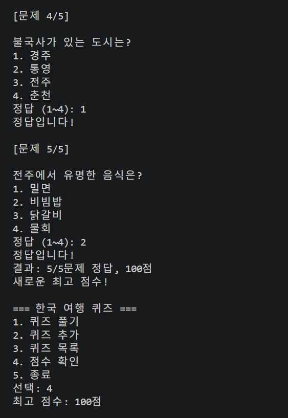
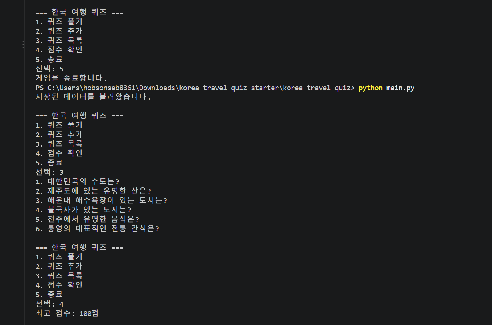
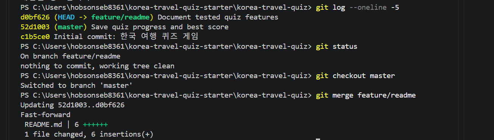
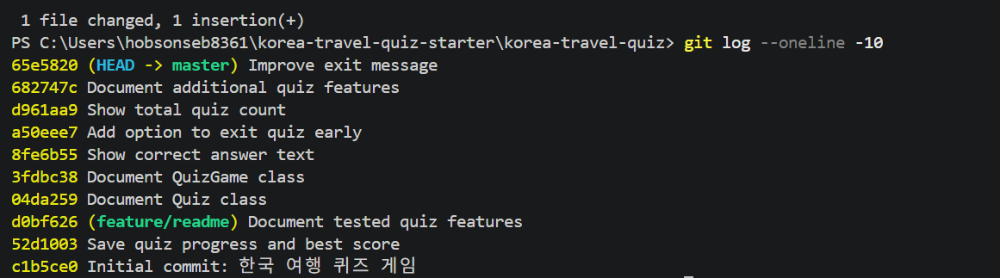
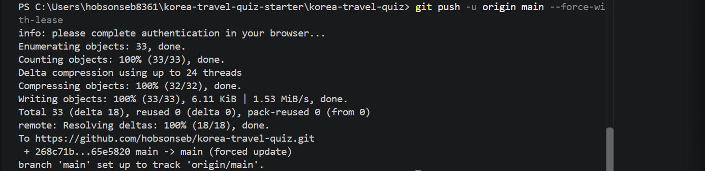
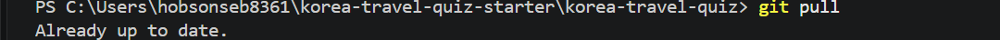
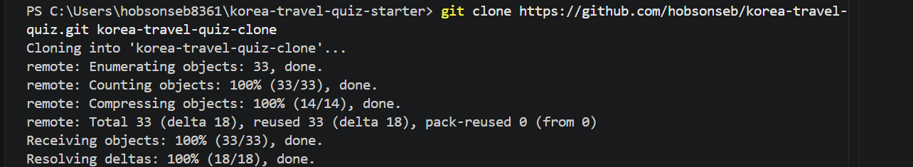

# 한국 여행 퀴즈 게임

Python으로 만든 콘솔 기반 한국 여행 퀴즈 게임입니다.  
한국의 지역, 관광지, 음식과 관련된 문제를 풀 수 있으며 새로운 문제를 직접 추가할 수도 있습니다.

퀴즈 데이터와 최고 점수는 `state.json` 파일에 저장되어 프로그램을 종료한 뒤 다시 실행해도 유지됩니다.

## 주요 기능

### 1. 퀴즈 풀기
- 저장된 한국 여행 퀴즈를 순서대로 풀 수 있습니다.
- 각 문제는 4개의 선택지로 구성되어 있습니다.
- 정답과 오답 여부를 바로 확인할 수 있습니다.
- 오답일 경우 정답 번호와 정답 내용을 함께 보여줍니다.
- 퀴즈 진행 중 `0`을 입력하면 메인 메뉴로 돌아갈 수 있습니다.
- 모든 문제를 풀면 최종 점수와 최고 점수를 확인할 수 있습니다.

### 2. 새 퀴즈 추가
사용자가 직접 새로운 퀴즈를 추가할 수 있습니다.

입력 항목:
- 문제
- 선택지 4개
- 정답 번호

추가된 문제는 `state.json`에 저장되기 때문에 프로그램을 다시 실행해도 유지됩니다.

### 3. 퀴즈 목록 확인
현재 저장되어 있는 모든 퀴즈를 확인할 수 있습니다.

- 전체 퀴즈 개수를 표시합니다.
- 각 퀴즈의 문제와 선택지를 확인할 수 있습니다.

### 4. 최고 점수 확인
퀴즈를 완료하면 기존 최고 점수와 비교하여 더 높은 점수를 저장합니다.

저장된 최고 점수는 프로그램을 다시 실행한 후에도 확인할 수 있습니다.

### 5. 입력 오류 처리
메뉴 선택, 정답 입력 등 숫자가 필요한 부분에 잘못된 값을 입력했을 경우 프로그램이 종료되지 않고 다시 입력할 수 있도록 처리했습니다.

## 프로그램 구조

프로그램은 `Quiz`와 `QuizGame` 클래스를 중심으로 구성했습니다.

### Quiz 클래스
하나의 퀴즈 문제에 필요한 정보를 관리합니다.

- 문제
- 4개의 선택지
- 정답 번호

### QuizGame 클래스
게임 전체의 실행과 데이터 관리를 담당합니다.

주요 역할:
- 메인 메뉴 실행
- 퀴즈 진행
- 새로운 문제 추가
- 퀴즈 목록 출력
- 최고 점수 관리
- `state.json` 데이터 저장 및 불러오기

## 파일 구성

```text
korea-travel-quiz/
├── main.py
├── state.json
├── README.md
└── .gitignore
```

- `main.py` : 퀴즈 게임의 주요 Python 코드
- `state.json` : 퀴즈 문제와 최고 점수 데이터
- `README.md` : 프로젝트 설명 및 실행 방법
- `.gitignore` : Git에서 추적하지 않을 파일 설정

## 실행 환경

- Python 3.10 이상
- 외부 라이브러리 사용 없음
- Python 표준 라이브러리만 사용

## 실행 방법

프로젝트 폴더에서 터미널을 열고 다음 명령어를 실행합니다.

```bash
python main.py
```

Windows에서 `python` 명령어가 동작하지 않을 경우 다음 명령어를 사용할 수 있습니다.

```bash
py main.py
```

별도의 외부 라이브러리 설치는 필요하지 않습니다.

## 게임 메뉴

프로그램을 실행하면 다음과 같은 메뉴를 사용할 수 있습니다.

```text
1. 퀴즈 풀기
2. 새 퀴즈 추가
3. 퀴즈 목록 보기
4. 최고 점수 보기
5. 종료
```

원하는 메뉴의 번호를 입력하여 기능을 실행합니다.

## 데이터 저장

게임 데이터는 `state.json` 파일에 저장됩니다.

저장되는 주요 데이터:
- 퀴즈 문제
- 선택지
- 정답
- 최고 점수

새로운 문제를 추가하거나 최고 점수가 변경되면 데이터가 저장됩니다. 따라서 프로그램을 종료한 후 다시 실행해도 이전 데이터를 불러올 수 있습니다.

## 테스트 결과

다음 기능을 직접 실행하여 확인했습니다.

- 퀴즈 실행 및 점수 표시 확인
- 정답 및 오답 처리 확인
- 오답 시 정답 번호와 정답 내용 표시 확인
- 퀴즈 진행 중 메인 메뉴로 돌아가기 확인
- 새로운 퀴즈 문제 추가 확인
- 게임 재실행 후 추가한 문제 저장 확인
- 전체 퀴즈 개수 표시 확인
- 최고 점수 저장 및 조회 확인
- 프로그램 재실행 후 최고 점수 유지 확인
- 종료 메시지 출력 확인

## Git 사용

프로젝트의 변경 과정을 Git으로 관리했습니다.

사용한 주요 명령어:
- `git init`
- `git add`
- `git commit`
- `git checkout`
- `git push`
- `git pull`
- `git clone`

기능 추가와 문서 수정을 각각 의미 있는 단위로 나누어 커밋했으며, 별도의 기능 브랜치에서 작업한 후 메인 브랜치에 병합하는 과정도 진행했습니다.

## GitHub

프로젝트 저장소:

`https://github.com/hobsonseb/korea-travel-quiz`

## 프로젝트를 통해 학습한 내용

이번 프로젝트를 통해 Python으로 간단한 콘솔 프로그램을 구성하고, 클래스와 JSON 파일을 이용하여 데이터를 관리하는 방법을 연습했습니다.

또한 Git을 이용해 코드 변경 사항을 단계별로 기록하고, 브랜치를 활용한 작업과 GitHub 원격 저장소의 `push`, `pull`, `clone` 과정을 직접 진행했습니다.
## 실행 및 테스트 화면

### 퀴즈 실행 결과
5개의 기본 퀴즈를 풀고 점수와 최고 점수가 정상적으로 표시되는 것을 확인했습니다.



### 새로운 퀴즈 추가
새로운 문제를 추가한 후 퀴즈 목록에 총 6개의 문제가 표시되는 것을 확인했습니다.



### 데이터 저장 확인
프로그램을 종료하고 다시 실행한 후에도 추가한 문제와 최고 점수가 유지되는 것을 확인했습니다.




## Git 작업 과정

### 브랜치 작업 및 병합
`feature/readme` 브랜치에서 작업한 내용을 메인 브랜치에 병합했습니다.



### 커밋 기록
기능 추가와 문서 수정 과정을 의미 있는 단위로 나누어 10개의 커밋으로 기록했습니다.



### GitHub Push
로컬 저장소의 작업 내용을 GitHub 원격 저장소에 업로드했습니다.



### Git Pull
원격 저장소와 로컬 저장소가 최신 상태인지 확인했습니다.



### Git Clone
GitHub 저장소를 새로운 폴더에 복제하여 정상적으로 내려받을 수 있는지 확인했습니다.

